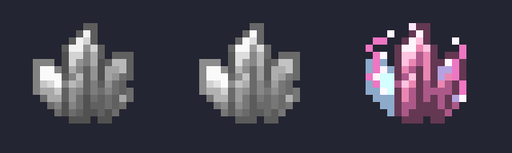
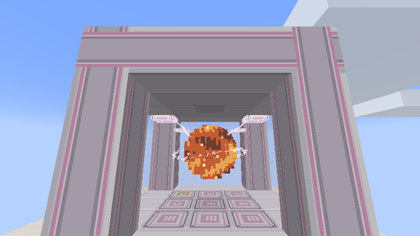

# Lightning Tech: Simulation

[简体中文](README.md) · [Changelog](CHANGELOG.md) · [License scope](LICENSES.md)

By **qiqi**. A **Minecraft 1.21.1 / NeoForge** addon for AE2 Lightning Tech.
Grow reusable simulation crystals with lightning, then use an ME network
to produce minerals, crops, wood and mob loot.

Current development version: **0.2.0-alpha.17**. Includes lasers, particle
constrainers, automatic construction and the high-energy workstation, with
survival recipes and compatibility with current Lightning Tech and AE2.
Use **Title screen → Mods → Lightning Tech: Simulation → Config** to tune
machine values, capacities and the explosion switch. See [configuration instructions](docs/MACHINE_CONFIGURATION.md).



## Installation

Use **Java 21** and install the same addon version on the client and server.
Place the ordinary mod JAR in your instance's `mods/` directory. Back up your
world before upgrading and remove the old addon JAR. The sources JAR and source
ZIP are development downloads, not game mods.

| Required component | Supported version |
| --- | --- |
| Minecraft | 1.21.1 |
| NeoForge | ≥21.1.252, <21.2; tested 21.1.252 / 21.1.255 |
| Applied Energistics 2 | ≥19.2.17, <20; tested 19.2.17 / 19.2.18 |
| AE2 Lightning Tech | ≥2.1.0, <3; tested old Reborn 2.1.0 / current main project 2.1.1 |
| Thunderbolt Core | ≥2.0.0, <3; tested 2.0.0 / 2.0.2 |
| GuideME | ≥21.1.19, <21.2; tested 21.1.19 |

Metadata admits later updates in these series; tested versions are listed separately.
Future API changes may still require adaptation, and upstream dependency ranges
also apply. Reborn and the current main project share mod IDs: install one set,
never both. See the [compatibility matrix](docs/development-upstream-compatibility.md).
Mekanism is optional; compatibility was tested with 10.7.19.85.
Mystical Agriculture 8.0.28 and Cucumber 8.0.16 are optional crop test mods.
Minecraft and dependency binaries are not distributed by this repository.

## Features

- **Simulation crystals:** blank → bound to a resource → perfect after ten more
  cultivation strikes. Natural, artificial and command-spawned lightning work
  by default; datapacks can restrict lightning types.
- **Material binding:** surround a lightning collector with 24 matching blocks
  in a horizontal 5×5 area. Use raw mineral blocks, or storage blocks for minerals
  such as diamonds. Crops sit above farmland at the collector's height; saplings
  sit above suitable soil. A strike consumes the materials/plants and keeps soil.
- **Mob binding:** a lightning hit while holding a blank crystal in the offhand
  has a **33%** chance to record the nearest eligible living entity within five
  blocks. Creative mode works; spawn-egg-backed mod entities are generally eligible.
  The Wither, Ender Dragon and Warden have explicit loot rules.
- **Single-block chamber:** up to 128 parallel operations with Lightning Collapse
  Matrices, four acceleration cards, automatic output, overload frequency control
  and continuous FE charging from the ME network.
- **Multiblock chamber:** external cubes from 3×3×3 to 7×7×7 support
  9 / 16 / 25 / 36 / 49 crystals. Frames form the edges and entire roof,
  vibrant quartz glass forms four sides, and frames/upgrades fill the floor.
  The controller and optional overload ME interface sit on non-corner bottom edges.
- Each participating multiblock crystal costs **1000 FE + 1 HV lightning** per
  **180-tick** base cycle. Efficiency removes up to 104 ticks; fortune reaches
  ×1024. Overload adds 1 EHV per crystal and halves the final cycle; smelting adds
  2 HV per crystal and doubles mapped smelting outputs, including ancient debris.
  Payment occurs on completion. Changing crystals cancels the batch without charge.
- **128 output buffer slots, each holding up to 1024 items.** Extraction splits
  oversized buffers into normal stacks. The formed structure's overload interface
  forwards products to ME storage; rejected items remain in the buffer.
- **Overload Thunder Coil:** install a core and modules at the overload equipment
  workstation and bind the tool to your network. Release a short right-click to
  strike a target, or charge for 1.5 seconds to strike yourself. Artificial lightning
  costs 10 HV; the enabled extreme-voltage module uses 10 EHV for natural lightning.
- Coil modules offer netherite-tier mimic tools, ultimate destruction, Efficiency X,
  Fortune V, Silk Touch, native T1/T2/T3 energy modules and wrench mode.
  Wrench mode supports AE2 and the optional Mekanism configurator.
  **Shift + scroll** cycles configurator modes.
- **Lasers and particles:** a high-energy laser emitter, five matrix types,
  collapse core and spherical particle constrainer, with server energy/lightning
  accounting, particle storage and optional Applied Flux integration.
- **Automatic construction:** laser/particle controllers and the simulation chamber
  take materials from player inventory first, then the connected AE network.
  Constrainers use a two-layer base with a front-mounted controller.

Hold **G** over an item for its guide. Press G while holding the coil for equipment
configuration. See [manufacturing recipes](docs/manufacturing-recipes.md) for all
18 recipes, materials and energy/lightning costs.



## Modpack and addon APIs

Datapack recipes, public tags, output providers and cancellable Java events allow
custom integration. No direct KubeJS dependency is required.

- [Datapack and Java API](docs/api.md)
- [Mineral/entity compatibility](docs/compatibility-api.md)
- [Crop and Mystical Agriculture compatibility](docs/crop-compatibility-api.md)
- [Multiblock structure, upgrades and settlement](docs/multiblock-api.md)
- [Laser and particle configuration/API](docs/laser-particle-api.md)

Explicit recipes take precedence over automatic matching. Automatic simulation does
not clone individual entity equipment/NBT, source farmland tiers, crux requirements
or plant block entities. Use the APIs for special content. AE2 templates and item
transport work; native AE2 CPU on-demand crafting integration is not implemented.

## Building

Install a **Java 21 JDK**; artifact verification also requires **Python 3.11+**.
The checked-in Gradle 8.8 wrapper verifies its downloaded
distribution. Dependency URLs and SHA-256 values are pinned in
[scripts/dependencies.json](scripts/dependencies.json). Downloaded binaries stay in
ignored `libs/` and are not bundled.

Windows PowerShell:

```powershell
.\scripts\bootstrap.ps1
.\gradlew.bat verifyReleaseVersion build runGameTestServer --no-daemon
python .\scripts\verify-release.py
```

Linux/macOS, with PowerShell 7 (`pwsh`) for dependency downloads:

```bash
pwsh -File scripts/bootstrap.ps1
chmod +x gradlew
./gradlew verifyReleaseVersion build runGameTestServer --no-daemon
python3 scripts/verify-release.py
```

Build artifacts are in `build/libs/`; `mod_version` in `gradle.properties`
is the single version source. See [CONTRIBUTING.md](CONTRIBUTING.md) for tests
and Blockbench editing.

## Licensing and feedback

Code, documentation and original artwork use **MIT**. Crystal artwork, the crystal
logo and seven module icons adapted from AE2 Lightning Tech Reborn retain
**CC BY-NC-SA 3.0**. See [LICENSES.md](LICENSES.md) and
[THIRD_PARTY_NOTICES.md](THIRD_PARTY_NOTICES.md) for scope, sources and changes.
This is an independent addon project.

Use the repository's bilingual issue templates and include exact versions,
reproduction steps and a log/crash report. Historical validation is recorded in
[docs/verification.md](docs/verification.md). Long-running worlds, multiplayer
and additional third-party mods need further testing.

Overload Output Interface adds 36 virtual resource slots, wired neighbor output and slot-specific wireless targets. It accepts no passive input. See [output interface API and configuration](docs/output-interface-api.md).
